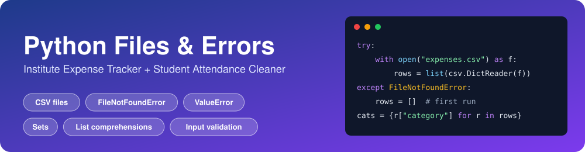
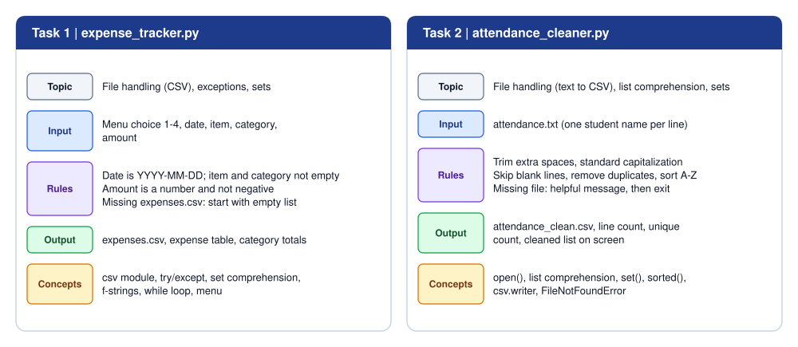
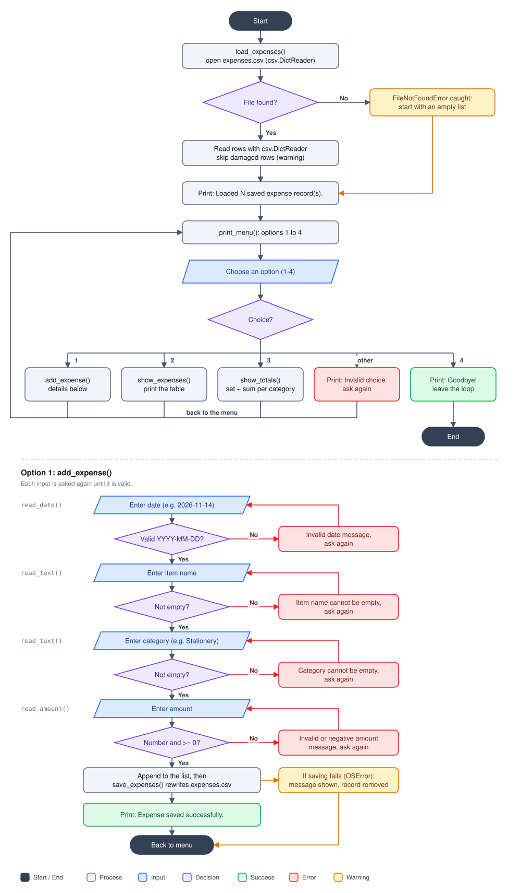
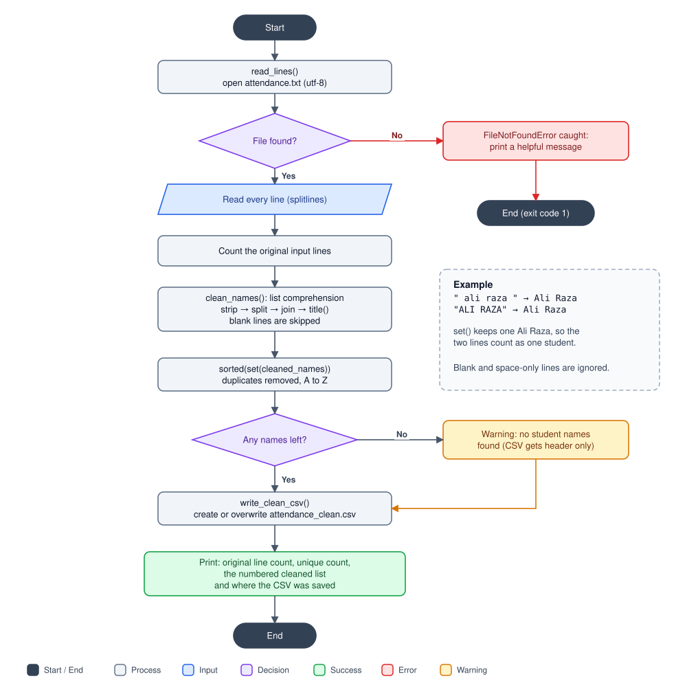
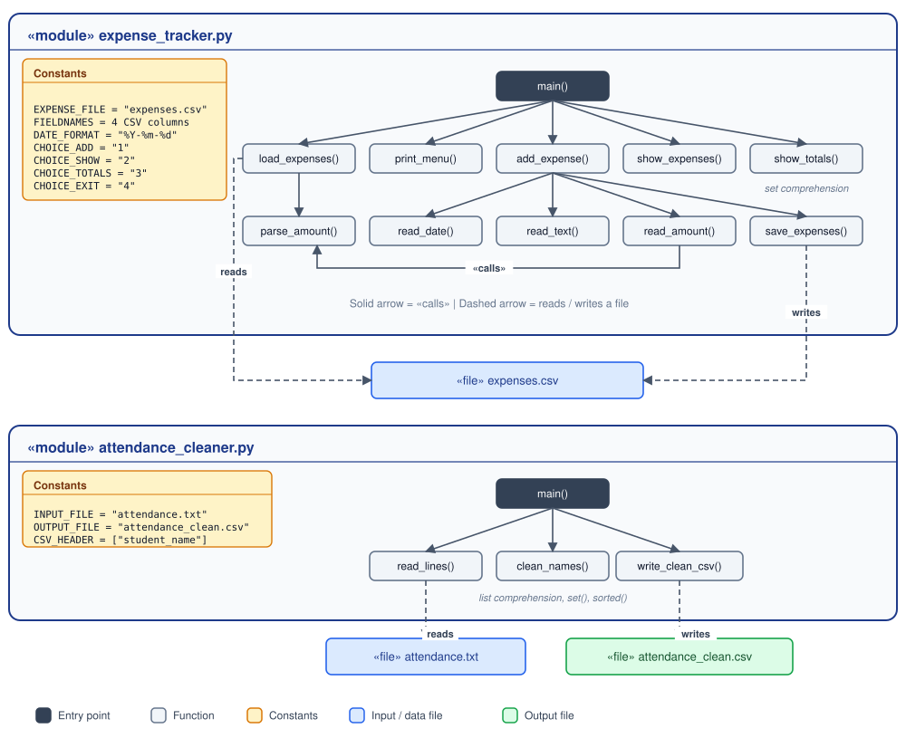

<p align="center"></p>

Two beginner-friendly Python command-line applications for a training institute: an **Institute Expense Tracker** that saves expenses to a CSV file, and a **Student Attendance Cleaner** that tidies a list of names. Both programs handle file and input errors without crashing.

## 1. Project Overview

| # | Task | File | Topic |
|---|---|---|---|
| 1 | Institute Expense Tracker | `expense_tracker.py` | CSV file handling, `FileNotFoundError`, `ValueError`, set |
| 2 | Student Attendance Cleaner | `attendance_cleaner.py` | Text to CSV, `FileNotFoundError`, list comprehension, set |

`attendance.txt` is the sample input file for Task 2. `expenses.csv` and `attendance_clean.csv` are created by the programs when they run.



## 2. Folder Structure

```text
python-files-errors-assessment/
├── assets/
│   ├── attendance_flow.svg
│   ├── banner.svg
│   ├── expense_flow.svg
│   ├── overview.svg
│   └── uml_diagram.svg
├── attendance.txt
├── attendance_cleaner.py
├── expense_tracker.py
└── README.md
```

`assets/` holds the SVG images used in this README. It is the only folder besides the required files.

## 3. Task Details

### Task 1: Institute Expense Tracker (`expense_tracker.py`)

**Summary.** A menu-driven program that records daily operational expenses (stationery, internet bills, refreshments, transport). Records are stored in `expenses.csv` with the columns `date,item,category,amount`, loaded when the program starts, and saved immediately after each new expense. A set shows each expense category only once.

**Rules**

- Load previously saved records at start-up; a missing file means an empty list.
- Add a new expense and save it immediately.
- Display all saved expenses.
- Calculate the total for each category and show the unique categories using a set.
- Reject a non-numeric or negative amount and ask again.

**Program Flow**



**Code Methods Description**

| Method / section | Purpose |
|---|---|
| Constants (`EXPENSE_FILE`, `FIELDNAMES`, `DATE_FORMAT`, `CHOICE_*`) | Keep the file name, CSV columns, date format and menu keys in one place |
| `parse_amount(text)` | Convert text to a finite number; raises `ValueError` for `abc`, `nan`, `inf` |
| `load_expenses(filename)` | Read `expenses.csv` into a list of dictionaries; `FileNotFoundError` gives an empty list; damaged rows are skipped with a warning |
| `save_expenses(expenses, filename)` | Write the header and all records, amounts with two decimals |
| `read_date()` | Ask until the date is a real `YYYY-MM-DD` date |
| `read_text(prompt, label)` | Ask until the text is not empty; extra spaces are removed |
| `read_amount()` | Ask until the amount is a number that is not negative |
| `add_expense(expenses)` | Collect the four fields, add the record, save it immediately |
| `show_expenses(expenses)` | Print all records as a numbered table |
| `show_totals(expenses)` | Build the set of unique categories, then print each category total and the grand total |
| `print_menu()` | Print the four menu options |
| `main()` | Load saved data, run the menu loop, handle end of input (Ctrl+D / Ctrl+Z) and Ctrl+C |

**Input Validation**

| Input | Rule | Message shown |
|---|---|---|
| Menu choice | Must be `1`, `2`, `3` or `4` | `Invalid choice. Please enter 1, 2, 3 or 4.` |
| Date | Real calendar date in `YYYY-MM-DD` | `Invalid date. Use the format YYYY-MM-DD, such as 2026-11-14.` |
| Item name | Not empty | `Item name cannot be empty.` |
| Category | Not empty; stored in Title Case | `Category cannot be empty.` |
| Amount | A finite number (`ValueError` otherwise) | `Invalid amount. Please enter a number, such as 250 or 250.50.` |
| Amount | Not negative (0 is allowed) | `Amount cannot be negative. Please enter 0 or more.` |
| `expenses.csv` missing | `FileNotFoundError` caught: normal on the first run | No message; starts with an empty list |
| Damaged CSV row | Row cannot be converted | `Warning: skipped damaged row N in expenses.csv.` |

**Expected Results.** After each new expense the file `expenses.csv` contains the header and one line per record, for example `2026-11-14,Printer paper,Stationery,1200.00`. The next run reports how many records it loaded. Option 2 prints a table of all records and option 3 prints the unique categories with a total for each.

### Task 2: Student Attendance Cleaner (`attendance_cleaner.py`)

**Summary.** Reads one student name per line from `attendance.txt`, removes extra spaces, standardizes capitalization, removes duplicate names, sorts the names alphabetically and writes them to `attendance_clean.csv` (header `student_name`).

**Rules**

- Remove surrounding and repeated spaces; skip blank lines.
- Standardize capitalization (Title Case), so ` ali raza ` and `ALI RAZA` become `Ali Raza`.
- Count them once: duplicates are removed with a set.
- Sort alphabetically and write the result to `attendance_clean.csv`, overwriting any old file.
- If `attendance.txt` is missing, show a helpful message and exit instead of crashing.

**Program Flow**



**Code Methods Description**

| Method / section | Purpose |
|---|---|
| Constants (`INPUT_FILE`, `OUTPUT_FILE`, `CSV_HEADER`) | File names and the CSV header in one place |
| `read_lines(filename)` | Open the file as UTF-8 (a BOM is ignored) and return its lines |
| `clean_names(original_names)` | List comprehension that trims, fixes spacing and capitalization, and skips blank lines |
| `write_clean_csv(names, filename)` | Create or overwrite the output CSV, one name per row |
| `main()` | Read, clean, `sorted(set(...))`, write, print the summary; returns `0` on success and `1` on an error |

**Input Validation**

| Situation | Handling | Message shown |
|---|---|---|
| `attendance.txt` missing | `FileNotFoundError` caught, exit code 1 | `Error: 'attendance.txt' was not found. Put it in the same folder as this program and run it again.` |
| File is not UTF-8 text | `UnicodeDecodeError` caught, exit code 1 | `Error: 'attendance.txt' is not a valid UTF-8 text file.` |
| File cannot be read or written | `OSError` caught, exit code 1 | `Error: could not read ...` / `Error: could not write ...` |
| Blank or space-only line | Skipped by the `if name.strip()` filter | None |
| No names at all | Warning; CSV gets only the header | `Warning: no student names were found in 'attendance.txt'.` |

**Expected Results.** The screen shows the original number of input lines, the number of unique students and the numbered cleaned list. The file `attendance_clean.csv` holds the same sorted names, one per row, under the header `student_name`.

## 4. UML Diagram

A **module diagram** was chosen because both programs are procedural (constants and functions, no classes); it shows the files, constants, functions, `«calls»` arrows and the data files each module reads or writes.



## 5. Concepts and Techniques Used

- File handling with `open()` and `with`, reading and writing text and CSV (`csv.DictReader`, `csv.DictWriter`, `csv.writer`)
- Exception handling: `FileNotFoundError`, `ValueError`, `UnicodeDecodeError`, `OSError`, `EOFError`
- Input validation loops (`while True` with `continue` / `return`)
- Sets, list comprehensions and `sorted()`
- Small reusable functions, constants instead of magic numbers, f-strings with formatting (`:<20`, `:>12.2f`)
- Exit codes (`sys.exit(main())`) for the attendance program

**Sets and list comprehensions**

- **Set in the Expense Tracker:** `{expense["category"] for expense in expenses}` collects each category once, so repeated categories are displayed only once.
- **List comprehension in the Attendance Cleaner:** `[" ".join(name.strip().split()).title() for name in original_names if name.strip()]` cleans each non-empty line. `strip()` removes surrounding whitespace, `split()` separates words and removes repeated internal spaces, `" ".join(...)` puts single spaces between words, and `title()` standardizes capitalization.
- **Set in the Attendance Cleaner:** `set(cleaned_names)` removes duplicate names after capitalization and whitespace have been standardized. For example, ` ali raza ` and `ALI RAZA` both become `Ali Raza`, then count as one student.

## 6. How to Run

**Requirements:** Python 3.8 or later. No extra packages are needed.

```bash
git clone https://github.com/muzammalali08765/python-files-errors-assessment.git
cd python-files-errors-assessment
```

Run each program from inside this folder (the cleaner needs `attendance.txt` next to it):

```bash
python expense_tracker.py
python attendance_cleaner.py
```

Alternative commands: use `python3 expense_tracker.py` and `python3 attendance_cleaner.py` on macOS or Linux, or `py expense_tracker.py` and `py attendance_cleaner.py` on Windows.

In the Expense Tracker choose `1` to add an expense, `2` to view records, `3` for category totals, or `4` to exit.

## 7. Sample Execution

All outputs below were produced by running the programs (typed answers are shown after each prompt).

**Expense Tracker: first run (no `expenses.csv`), with an invalid amount**

```text
Loaded 0 saved expense record(s).

===== INSTITUTE EXPENSE TRACKER =====
1. Add New Expense
2. Show All Expenses
3. Calculate Total Expenses by Category
4. Exit
Choose an option (1-4): 1
Enter date (e.g. 2026-11-14): 2026-11-14
Enter item name: Printer paper
Enter category (e.g. Stationery): stationery
Enter amount: abc
Invalid amount. Please enter a number, such as 250 or 250.50.
Enter amount: 1200
Expense saved successfully.

===== INSTITUTE EXPENSE TRACKER =====
1. Add New Expense
2. Show All Expenses
3. Calculate Total Expenses by Category
4. Exit
Choose an option (1-4): 4
Goodbye!
```

The program creates `expenses.csv`:

```csv
date,item,category,amount
2026-11-14,Printer paper,Stationery,1200.00
```

**Expense Tracker: second run loads the saved record**

```text
Loaded 1 saved expense record(s).

===== INSTITUTE EXPENSE TRACKER =====
1. Add New Expense
2. Show All Expenses
3. Calculate Total Expenses by Category
4. Exit
Choose an option (1-4): 2

===== ALL EXPENSES =====
No.  Date        Item                      Category            Amount
---------------------------------------------------------------------
1    2026-11-14  Printer paper             Stationery         1200.00

===== INSTITUTE EXPENSE TRACKER =====
1. Add New Expense
2. Show All Expenses
3. Calculate Total Expenses by Category
4. Exit
Choose an option (1-4): 4
Goodbye!
```

**Expense Tracker: all expenses and category totals** (after the records from the test cases in section 8 were added)

```text
Loaded 5 saved expense record(s).

===== INSTITUTE EXPENSE TRACKER =====
1. Add New Expense
2. Show All Expenses
3. Calculate Total Expenses by Category
4. Exit
Choose an option (1-4): 2

===== ALL EXPENSES =====
No.  Date        Item                      Category            Amount
---------------------------------------------------------------------
1    2026-11-14  Printer paper             Stationery         1200.00
2    2026-11-15  Internet bill             Internet           3500.50
3    2026-11-16  Tea and biscuits          Refreshments        450.00
4    2026-11-16  Bus fare                  Transport           300.00
5    2026-11-17  Free sample               Stationery            0.00

===== INSTITUTE EXPENSE TRACKER =====
1. Add New Expense
2. Show All Expenses
3. Calculate Total Expenses by Category
4. Exit
Choose an option (1-4): 3

===== TOTAL EXPENSES BY CATEGORY =====
Unique categories (4): Internet, Refreshments, Stationery, Transport
--------------------------------
Internet                 3500.50
Refreshments              450.00
Stationery               1200.00
Transport                 300.00
--------------------------------
Grand total              5450.50

===== INSTITUTE EXPENSE TRACKER =====
1. Add New Expense
2. Show All Expenses
3. Calculate Total Expenses by Category
4. Exit
Choose an option (1-4): 4
Goodbye!
```

**Attendance Cleaner: success** (using the supplied `attendance.txt`)

```text
Original input lines : 14
Unique students      : 8

===== CLEANED ATTENDANCE LIST =====
1. Ahmed Ali
2. Ali Raza
3. Bilal Ahmed
4. Fatima Noor
5. Hamza Tariq
6. Noor Ul Ain
7. Sara Khan
8. Zainab Fatima

Saved to attendance_clean.csv
```

`attendance_clean.csv`:

```csv
student_name
Ahmed Ali
Ali Raza
Bilal Ahmed
Fatima Noor
Hamza Tariq
Noor Ul Ain
Sara Khan
Zainab Fatima
```

**Attendance Cleaner: failure (`attendance.txt` missing)**

```text
Error: 'attendance.txt' was not found. Put it in the same folder as this program and run it again.
```

## 8. Test Cases

Every case below was run against the final code. Test cases `E1` to `E7` continue in the same folder, one after another, so `E2` loads the record saved by `E1`. The cases cover the checklist from the brief: no `expenses.csv`, non-numeric amount, several categories across runs, viewing and totals, the supplied attendance file, name variations and the missing-file message.

**Expense Tracker**

| # | Scenario | Inputs | Expected result |
|---|---|---|---|
| E1 | First run, no expenses.csv (FileNotFoundError); amount `abc` rejected, then valid | 1, 2026-11-14, Printer paper, stationery, abc, 1200, 4 | `Loaded 0 saved expense record(s).`; `Invalid amount.` and the amount is asked again; record saved; `expenses.csv` created with the header and `2026-11-14,Printer paper,Stationery,1200.00` |
| E2 | Second run loads the saved record | 2, 4 | `Loaded 1 saved expense record(s).`; the Printer paper row is listed |
| E3 | Invalid dates rejected; category typed in capitals is stored as Title Case | 1, 14-11-2026, 2026-13-40, 2026-11-15, Internet bill, INTERNET, 3500.5, 4 | `Invalid date.` shown twice; record saved; category stored as `Internet`, amount as `3500.50` |
| E4 | Negative, `nan` and empty amounts rejected | 1, 2026-11-16, Tea and biscuits, refreshments, -50, nan, (empty), 450, 4 | `Amount cannot be negative.` once and `Invalid amount.` twice (`nan`, empty); `450.00` saved |
| E5 | Empty item name and empty category rejected | 1, 2026-11-16, (empty), Bus fare, (spaces), `  transport `, 300, 4 | `Item name cannot be empty.` and `Category cannot be empty.` once each; saved as `Bus fare,Transport,300.00` |
| E6 | Boundary: amount 0 is accepted | 1, 2026-11-17, Free sample, stationery, 0, 4 | `0` accepted; saved as `Free sample,Stationery,0.00` |
| E7 | Show all expenses, then totals (set of unique categories) | 2, 3, 4 | Table of 5 records; `Unique categories (4): Internet, Refreshments, Stationery, Transport`; totals 3500.50, 450.00, 1200.00, 300.00; grand total 5450.50 |
| E8 | Invalid menu choices (`9`, empty, `abc`) are rejected | 9, (empty), abc, 4 | `Invalid choice. Please enter 1, 2, 3 or 4.` three times; the menu returns each time; `4` exits; no CSV created |
| E9 | No records: options 2 and 3 show a message | 2, 3, 4 | `No expenses recorded yet.` for both options; no CSV created |
| E10 | Item containing a comma: saved with CSV quoting | 1, 2026-11-17, `Pens, blue (box)`, stationery, 99.99, 4 | Saved; the CSV stores the item in quotes: `"Pens, blue (box)"` |
| E11 | Comma item reloads correctly on the next run | 2, 4 | `Loaded 1 saved expense record(s).`; item shown correctly as `Pens, blue (box)` |
| E12 | Damaged rows in expenses.csv are skipped with a warning | 2, 4 (CSV has 2 good rows and 2 damaged rows) | `Loaded 2 saved expense record(s).`; warnings for rows 3 and 4; Chalk and Taxi are listed |
| E13 | Input ends (Ctrl+D / Ctrl+Z) in the middle of adding: no crash, nothing saved | 1, 2026-11-18, then input ends | `Goodbye!` printed, no traceback, no `expenses.csv` created |

**Attendance Cleaner**

| # | Scenario | Inputs | Expected result |
|---|---|---|---|
| A1 | Supplied sample file (spaces, capitals, duplicates, blank lines) | Supplied `attendance.txt` (14 lines) | 14 input lines, 8 unique students, names sorted A-Z, `attendance_clean.csv` saved |
| A2 | attendance.txt is missing (FileNotFoundError) | No `attendance.txt` | `Error: 'attendance.txt' was not found...`, exit code 1, no CSV created |
| A3 | Empty file | Empty `attendance.txt` | Warning shown, 0 unique students, CSV contains only the header |
| A4 | Only blank and space-only lines | 4 blank or space-only lines | 4 input lines, 0 unique students, CSV contains only the header |
| A5 | Existing attendance_clean.csv is overwritten | `zara malik` + old `attendance_clean.csv` containing `old data` | Old CSV is overwritten; it now holds `Zara Malik` |
| A6 | One student written three ways becomes one name | `  mUHAMMAD   aLI  `, `MUHAMMAD ALI`, `muhammad ali` | 3 input lines, 1 unique student: `Muhammad Ali` |
| A7 | UTF-8 BOM at the start and no final newline | UTF-8 BOM, `zara malik`, `OMAR farooq` (no final newline) | BOM ignored; 2 unique students: `Omar Farooq`, `Zara Malik` |
| A8 | attendance.txt is not valid text (binary bytes) | Binary bytes in `attendance.txt` | `...is not a valid UTF-8 text file.`, exit code 1, no CSV created |
| A9 | attendance.txt is a folder, so it cannot be read | `attendance.txt` is a folder | `Error: could not read 'attendance.txt'...`, exit code 1, no CSV created |

---

**Author:** Muzammal Ali | **GitHub:** [github.com/muzammalali08765/python-files-errors-assessment](https://github.com/muzammalali08765/python-files-errors-assessment)
